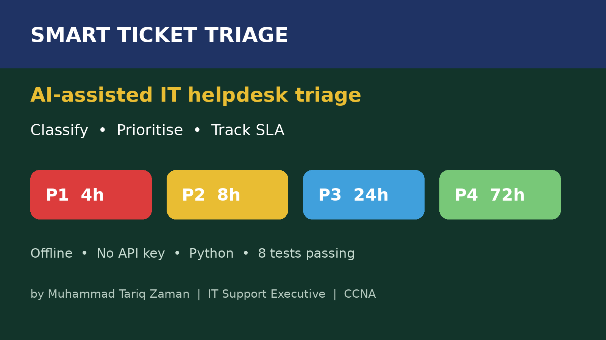
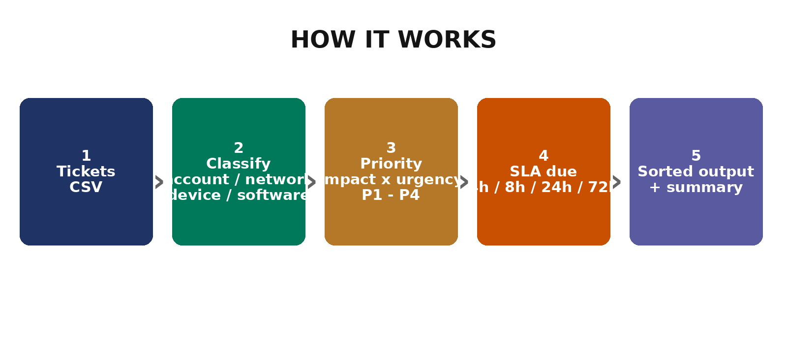

# Smart Ticket Triage

**AI-assisted IT helpdesk triage — classify, prioritise and SLA-track support tickets, fully offline.**



Service desks lose time deciding *what to work on first*. Smart Ticket Triage takes a CSV of
tickets and returns them sorted by priority, with a category and an SLA due time for each one —
so P1s never hide behind a queue of P4s.



## What it does

- **Classifies** each ticket: `account`, `connectivity`, `device`, `software`, or `general`
  (keyword-based, transparent — no black box, no API key, no data leaving your machine)
- **Prioritises** with an impact × urgency matrix: P1–P4
- **Computes SLA due times**: P1 = 4h, P2 = 8h, P3 = 24h, P4 = 72h
- **Outputs** a sorted triaged CSV plus a JSON summary (totals by category and priority)

## Why this matters right now

Helpdesk automation and AI-assisted triage are among the most in-demand IT support skills in
2026: teams want faster first response, honest SLA tracking, and tickets a junior engineer can
pick up without guessing. This project is built from real service-desk practice — 1,000+
tickets resolved within SLA — not from a tutorial dataset.

## Quick start

```bash
# No dependencies beyond Python 3.10+
PYTHONPATH=src python3 -m smart_ticket_triage examples/tickets.csv triaged.csv --summary summary.json
```

Input CSV columns: `id,title,description,impact,urgency,created_at`
(`impact`/`urgency` are `high`, `medium` or `low`; `created_at` is `YYYY-MM-DD HH:MM`.)

Example output (`triaged.csv`, sorted P1 first):

```csv
id,title,category,priority,sla_due,created_at
T1,WiFi down on floor 2,connectivity,P1,2026-10-25T13:00,2026-10-25 09:00
T2,Password reset,account,P2,2026-10-25T17:15,2026-10-25 09:15
```

## Quality assurance

- **8 automated tests, all passing** (standard library `unittest` only — no extra installs):
  ```bash
  python3 -m unittest discover -s tests -v
  ```
- Tests cover classification, the full priority matrix, invalid-input rejection,
  SLA arithmetic, and end-to-end CSV triage with P1-first sorting.
- The example in `examples/` was run and its output verified before publishing.

## Project layout

```
src/smart_ticket_triage/   # the tool (classify, priority, SLA, CSV triage)
tests/                     # 8 unittest tests
examples/tickets.csv       # 5 sample tickets
assets/                    # banner + workflow diagram
```

## Roadmap

- [ ] Severity scoring from ticket text alone (no impact/urgency columns needed)
- [ ] Export to HTML report with SLA breach highlighting
- [ ] Optional osTicket / CSV import from real helpdesk exports

## Licence

MIT — see `LICENSE`.
